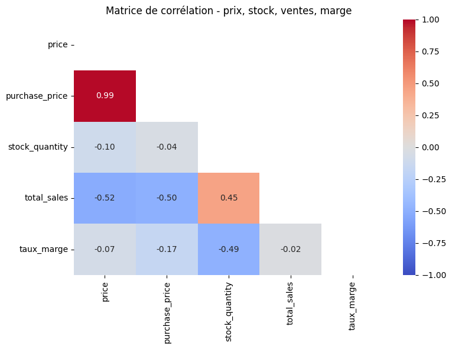

# Détection d'anomalies multivariée par IA — Catalogue Bottleneck

**Pilotez un projet data augmenté par l'IA** · Parcours Business Intelligence Analyst (RNCP37837, niveau 6) · Septembre 2026
**Aurélie Dupassieux** — [adupassieux-arch.github.io](https://adupassieux-arch.github.io)

> **In short (EN):** Approach inspired by a [published Walmart Labs case study](https://arxiv.org/abs/1902.09566) on e-commerce price anomaly detection. An AI-driven, documented upgrade of an earlier stock & sales analysis for an online wine merchant. Univariate outlier detection (Z-score / IQR on price) is complemented by a multivariate **Isolation Forest** on price, purchase price, stock, sales and margin. The model surfaces **16 anomalies invisible to the univariate approach**, tested for stability (96.9 % between seeds) and sensitivity, then reviewed product by product to separate a warning signal (slow-moving premium Champagne stock) from a positive one (high-margin, high-velocity entry-level wines).

---

## Contexte et besoin métier

Bottleneck est un caviste en ligne (client fictif). Le livrable de départ — le notebook du [Projet 6](https://github.com/adupassieux-arch/analyse-stock-ventes) — fiabilise une base croisant ERP, export web et table de liaison (9 erreurs de données corrigées) et détecte les prix atypiques par **Z-score et IQR**.

**Angle mort identifié :** cette détection est **univariée** et ne porte que sur le prix. Une anomalie métier — marge incohérente, stock dormant sur une référence premium — peut ne pas être atypique sur une seule variable, mais le devenir quand plusieurs variables sont observées ensemble.

**Mission :** améliorer le livrable de façon critique et documentée grâce à l'IA, en l'utilisant comme un levier testé, pas comme une boîte noire.

Démarche inspirée d'un [cas publié par Walmart Labs](https://arxiv.org/abs/1902.09566) sur la détection d'anomalies de prix en e-commerce.

## Veille et choix de la méthode

| Critère | Z-score / IQR (en place) | Isolation Forest (ajouté) |
|---|---|---|
| Détection multivariée | Non — variable par variable | Oui — croise plusieurs variables |
| Hypothèse de distribution | Normale (Z-score) ou aucune (IQR) | Aucune |
| Interprétabilité | Élevée — seuil chiffré | Moyenne — lecture par comparaison de profils |
| Robustesse petits volumes | Bonne | Correcte — variance testée |
| Biais / risque | Sur- ou sous-détection selon le seuil | Sensible au taux de contamination |

**Décision :** les deux méthodes sont **complémentaires**. Le Z-score / IQR reste le premier niveau de lecture ; Isolation Forest est ajouté pour capter les anomalies multivariées.

Sources : R. Rakotomalala (Université Lyon 2), Ramakrishnan et al. *Anomaly Detection for an E-commerce Pricing System* (Walmart Labs, arXiv 2019), documentation OneStream et scikit-learn.

## Démarche

- **Périmètre :** 712 produits disposant d'une correspondance web ; variables `price`, `purchase_price`, `stock_quantity`, `total_sales`, `taux_marge`.
- **Modèle :** `IsolationForest` (scikit-learn), 200 arbres, contamination 4,4 % (alignée sur le taux IQR pour comparer à volume égal), `random_state=42`.
- **Tests :** stabilité entre deux graines (42 / 7) ; sensibilité au taux de contamination (3 %, 5 %, 8 %).
- **Revue métier :** chaque anomalie détectée uniquement par Isolation Forest est examinée produit par produit avant toute conclusion.

## Résultats

| Indicateur | Résultat |
|---|---|
| Anomalies — IQR (prix seul) | 31 produits (4,4 %) |
| Anomalies — Isolation Forest | 32 produits (4,5 %) |
| Détectées par les deux méthodes | 16 |
| **Détectées par Isolation Forest uniquement** | **16** |
| Stabilité entre deux graines | 31 / 32 identiques (**96,9 %**) |
| Sensibilité (3 % / 5 % / 8 %) | 22 / 36 / 57 anomalies — progression cohérente |

**Lecture métier des 16 anomalies nouvelles :**

1. **Stock premium à rotation lente — à arbitrer (13 produits).** Douze Champagnes Grands Crus et une huile d'olive : prix dans la norme, marge de 23 % à 31 %, stock élevé (68 à 145 unités), ventes faibles ou nulles. Signal de **sur-stockage** à traiter commercialement (approvisionnement, mise en avant, prix). Cas prioritaire : 145 unités en stock, 0 vente sur la période.
2. **Succès commercial en entrée de gamme — insight positif (3 produits).** Vins de 5,20 € à 9,90 € combinant marge élevée (37 % à 41 %) et ventes élevées (20 à 36 unités) : un **axe de développement**, pas un problème.

Ces deux lectures, qu'un score d'anomalie unique aurait confondues, sont transmises au métier sous forme de **deux listes distinctes**.

  

## Limites

- Un seul mois de données (octobre) : une rotation nulle peut refléter une saisonnalité.
- Taux de contamination calibré par alignement sur l'IQR, pas sur un objectif métier propre (ex. capacité de revue de l'équipe vente).
- Isolation Forest ne fournit pas d'importance des variables : l'interprétation passe par la comparaison des profils moyens (prochaine piste : SHAP).

## Contenu du dépôt

| Fichier | Description |
|---|---|
| [`notebook_bottleneck_anomalies_ia.ipynb`](notebook_bottleneck_anomalies_ia.ipynb) | Notebook complet : nettoyage, analyses univariées et multivariées, Isolation Forest (étape 5.7), tests de robustesse |
| [`docs/documentation_demarche.pdf`](docs/documentation_demarche.pdf) | Documentation de la démarche : veille, cahier des charges, organisation, tests, résultats, limites, décisions |
| [`docs/soutenance.pdf`](docs/soutenance.pdf) | Support de soutenance |

Les fichiers sources (`erp.xlsx`, `web.xlsx`, `liaison.xlsx`) sont fournis par OpenClassrooms et ne sont pas redistribués ici. Pour réexécuter le notebook, placez-les à côté du fichier `.ipynb`.

**Outils :** Python · pandas · scikit-learn · matplotlib · seaborn · Jupyter

---

*Projets liés : [Projet 6 — Analyse du stock et des ventes](https://github.com/adupassieux-arch/analyse-stock-ventes) · [Dashboard interactif Bottleneck](https://adupassieux-arch.github.io/dashboard/)*
